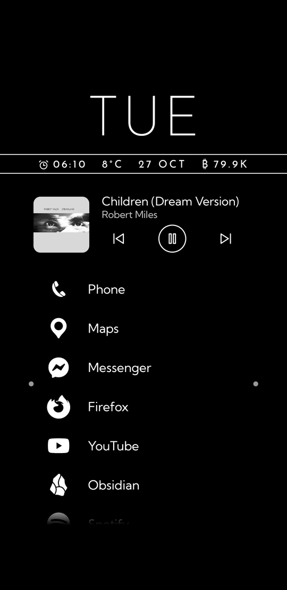
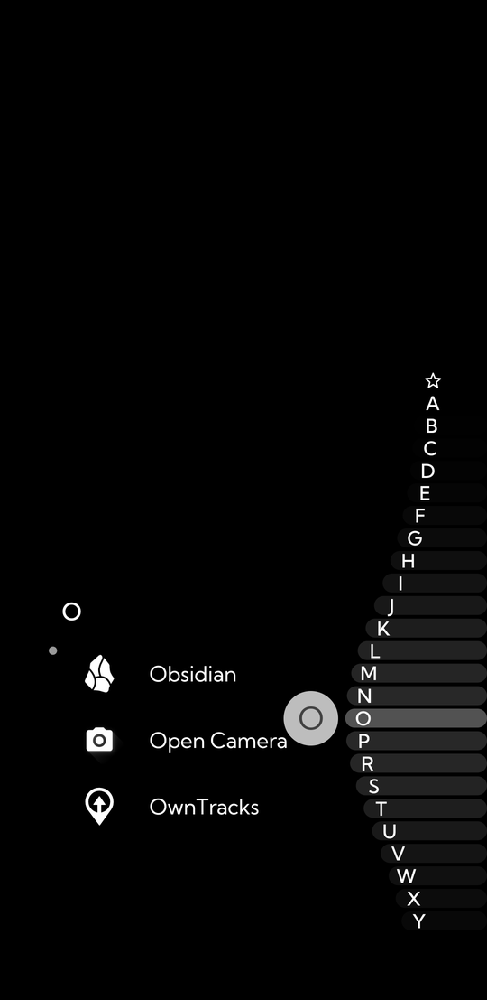
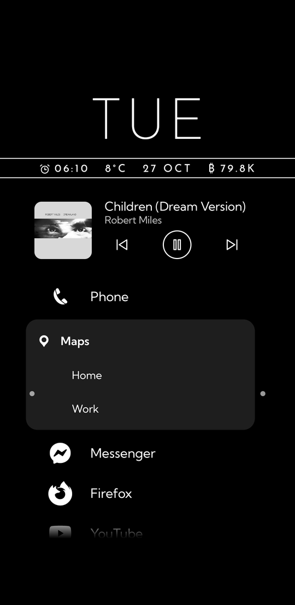
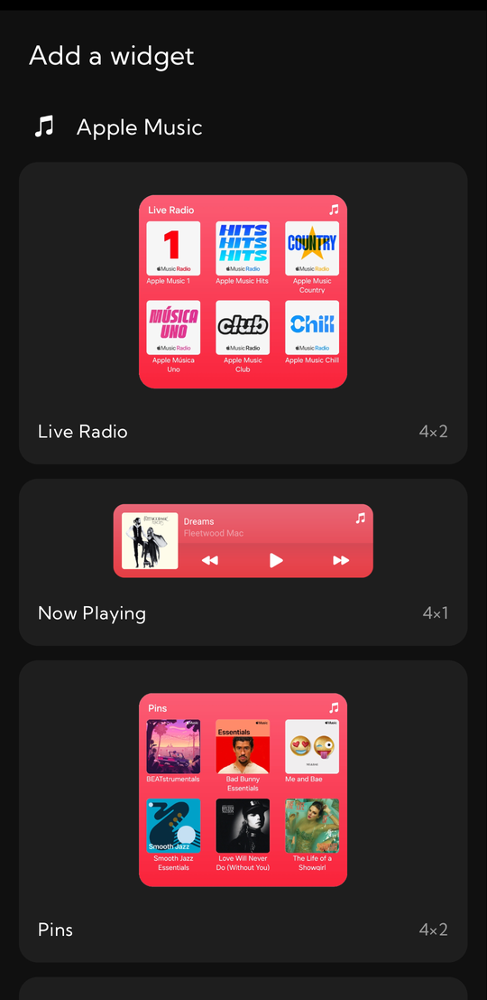
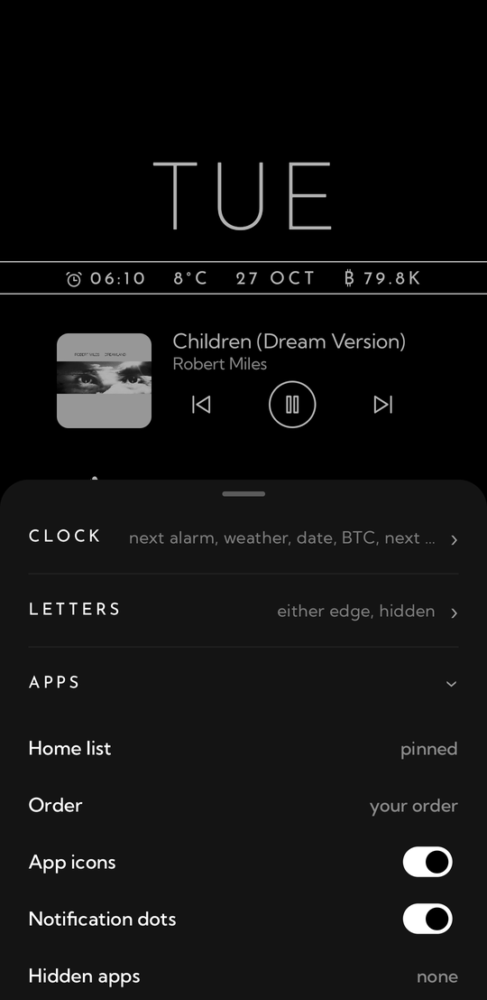
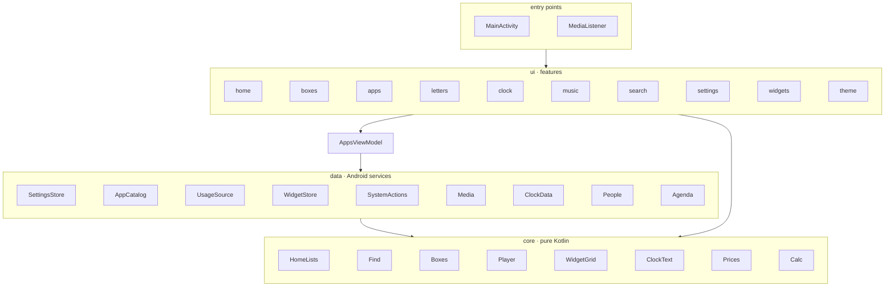

# Laconic

A minimal Android home screen: a clock, your pinned apps, and an A–Z strip that bows out under your thumb.
Free and open source, about 8,000 lines of Kotlin + Jetpack Compose with about 380 tests, a 3.0 MB APK.

*A personal project: I built it for my own phone (a Pixel) and use it every day. Bug reports and ideas are welcome,
but there are no promises on timing, and it is tested mainly on a Pixel, so expect rough edges elsewhere.*

<p>
  
  
  
  
  
  
</p>

## Features

- **Letter strip.** Touch or drag along the edge. The letters ride out on stripes in a wave around your finger, a bubble shows the letter, and only that letter's apps are listed. Slide onto an app and let go to open it — one gesture from home screen to app. The ☆ at the top shows your pinned apps.
- **Either hand.** Keep the strip on the right or the left edge, or hide it: a dot waits on each edge and the letters come out on whichever side you touch, with the lists mirrored away from that thumb. The strip starts just inside Android's Back-swipe zone, so a swipe in from the very edge is still Back.
- **Pinned apps.** Long-press any app in a letter list → *Pin to home*. The pinned list scrolls if it grows past the screen.
- **Or boxes.** *Layout → boxes* shows the pinned apps as icons in boxes that tile the space under the clock, like a tiling window manager: only the lines between boxes are drawn, none on the outer edge. Long-press to edit — split a box side by side or one above the other, drag a line to resize, hold and drag an app into another box or to a new spot, name a box (FINANCE, WORK…), remove one (its apps move to its neighbour). A box with more apps than fit scrolls. Both layouts show the same pins, so switching loses nothing.
- **Or the apps you use.** Home can list your 8 most used or most recent apps instead of your pins (from Android's usage data, last 14 days), in that order or A–Z.
- **Your names, your list.** Long-press an app to rename it or hide it from the lists; search finds it by either name, hidden or not. *Hidden apps* in the settings lists every app with a switch.
- **Notification dots.** A small dot between an app's icon and name while it has notifications waiting. Ongoing ones, like music or navigation, don't count.
- **Names only.** Switch *App icons* off for a list of just names.
- **Shortcuts.** Swipe an app to the right to open its shortcuts in place (Maps → Home, Work; Spotify → Liked songs …).
- **Swipe up for search.** From the empty band at the bottom, between the corner buttons: search opens with the keyboard up.
- **Corner buttons.** Flashlight bottom left, camera bottom right, where the lock screen has them — one tap. Long-press either to make it any app, or nothing.
- **Pull down.** Anywhere on the home screen, pulling down opens Android's notifications — or, with *Pull down for search* on, search: type a few letters, Enter opens the top match (marked with a small ↵-arrow). Accents don't matter. It also finds contacts and calendar events from two letters on (switch either off under *Search*; Android asks for the permission from the search itself). Results come in sections, apps first, with a few rows each and a *+N more* row. Small typos and initials work (*pe* finds Photo Editor). Tap a contact to see its numbers, emails and the actions other apps added (a call or message in a chat app); the phone glyph opens the dialler with the number typed in, it does not place the call, and the bubble starts a text. Enter on a contact opens the same view. Tap an event to open it in your calendar; events are the next 365 days. Start with `c `, `e `, `a ` or `w ` to search only contacts, events, apps or the web. A web address (or a home-network IP) opens in your browser, a sum like `12*7` shows its result (tap to copy), and when nothing matches, Enter searches the web.
- **Music.** While something plays — Spotify, YouTube Music, YouTube, any player — its cover (in black and white, to match the icons — or in colour, if you switch that on), title and ⏮ ⏯ ⏭ sit under the clock. Tap the cover or title to open the app; swipe it left to stop playback and put it away until something plays again. A paused player drops off after 10 minutes — and stays off when an app like Spotify restarts in the background and reports its old song as just paused.
- **Widget pages.** Up to three pages of ordinary Android widgets on each side of home — say two on the left and one on the right. Laconic's own picker shows every widget with its preview and size, and each widget starts at its own size, so two 2×2 widgets share a row. Long-press a widget to resize it — its height snaps in small steps and its width in quarters of the page — or remove it. With widget pages on, the pinned apps scroll in a shorter window and the space under it is free for swiping between pages.
- **Rearranging.** Long-press a pinned app on the home screen to enter edit mode: drag the ≡ handle to reorder, swipe a row right-to-left to unpin it, tap a row for *App info* / *Uninstall*. *Done*, Back or Home leaves edit mode.
- **Clock.** The weekday in thin capitals and a band carrying any of time · next alarm · weather · date · a price (switch each under *Clock* in the settings); your next calendar event sits underneath — tap it to open the event. The band runs above, through or below the weekday, and is plain, inverted (white, with the items in black) or drawn between two thin lines. Tap the clock to open your alarms.
- **Coming home.** Each time you return, the band grows out from the middle, the weekday comes out of it, the event line opens out after it, and the pinned apps drop in one by one. Switch it off under *Animations*.
- **Prices.** Bitcoin by default (₿ 80.4K). Any coin on Binance works (ETH 2318, SOL 182), and so do the stocks, ETFs and metals Binance lists as futures: SPY for the S&P 500, QQQ for the Nasdaq 100, XAU for gold, NVDA … Binance turns away US addresses; there, coins come from Coinbase instead, and stocks have no source.
- **Your colours.** *Ink* turns everything Laconic draws — clock, letters, lines, names, the black-and-white icons — any colour you pick; *Background* swaps the wallpaper for a solid colour. A note warns when the two are hard to read together.
- **Monochrome icons** from Android 13+ themed icons, with greyscale copies of the normal icon as a fallback.
- **One settings panel.** Long-press the clock or any empty spot: a sheet rises halfway, so the clock stays in view while you change it, with five folding sections — Clock, Letters, Apps, Search, Home — and the version at the bottom.
- **Stays out of the way.** No app drawer or settings screens; portrait only. Notifications, quick settings and recents are stock Android.

## Requirements

- Android 10 or newer (monochrome icons need Android 13).
- Works on any screen size and with large system font sizes: the clock and the letter strip keep a fixed size, app names follow your font setting. Tested on a Pixel 10, and at Galaxy A55 and small 360 dp screen sizes.
- Work-profile apps are listed alongside personal ones.
- English only for now, laid out left to right. The letter strip is A–Z: names in other scripts are listed under `#`, and accented letters go with their base letter (Á with A).

## Install

**[Download Laconic (APK) from the latest release](https://github.com/gyula-pal/laconic/releases/latest)**

Open the link on your phone and tap the `.apk` under *Assets*. When you open it, Android asks you to allow your browser to install apps; allow it once, then tap *Install*. Play Protect may warn that the developer is unknown, because Laconic isn't on the Play Store.

Or build it yourself (below) and install it with:

```bash
adb install -r app/build/outputs/apk/release/app-release.apk
```

Then press Home and choose **Laconic → Always**, or set it under *Settings → Apps → Default apps → Home app*. Android forgets this choice after each reinstall, so pick it again after updating.

## Permissions and privacy

| permission | used for | asked |
|---|---|---|
| Calendar (read) | the next-event line, and calendar events in search | when you tap *Tap to show next event*, or the *events · allow* line in search |
| Contacts (read) | contacts in search: names, numbers, emails. Laconic never places a call or sends a message itself; it hands the number or address to your dialler, messaging or mail app | the *contacts · allow* line in search |
| Approximate location | the temperature | when you tap *?°C* |
| Notification access | the music player (Android only shows other apps' media to apps with it) and the notification dots; Laconic notes only which apps have a notification waiting, never what it says | when you pick *Music controls* or *Notification dots* in the settings panel |
| Usage access | the most used / recent apps on home: which apps you opened, and when | when you pick *Most used* or *Recent* and tap *Tap to allow usage access* |
| Widgets | showing other apps' widgets | Android asks *Create widget and allow access?* when you add one (tick *Always allow* to skip it next time) |
| Expand status bar | pulling down for notifications | — |
| Internet | weather and Bitcoin price | — |
| Request uninstall | the *Uninstall* menu item (Android still asks you to confirm) | — |

Weather comes from [Open-Meteo](https://open-meteo.com/) with your location rounded to about 1 km. Prices are the last trade against USDT from Binance's public tickers (spot for coins, futures for stocks, ETFs and metals), so a stock's price moves outside market hours too; where Binance refuses the connection (the US), coins come from Coinbase's public prices. Prices refresh every 5 minutes and the weather every 15, only while the home screen is visible; if a refresh fails they show "—" rather than a stale value and try again after a minute. Turn either off under *Clock* in the settings panel and that request stops entirely.

Nothing else leaves the phone: no accounts, analytics, crash reporting or ads. What you type into search goes to the web only when you choose *Search the web* or open an address, and then to your phone's web search or browser (Google in a browser if nothing else handles it). Contacts and calendar events are read on the phone when you search and never stored or sent. Usage data and notifications are read on the phone and never stored or sent. Pins, names, hidden apps, widgets and settings are stored locally.

## Performance

Measured on a Pixel 10 with the home screen visible:

| | Laconic | Pixel Launcher |
|---|---|---|
| memory (PSS) once settled | ~110–120 MB | ~225 MB |
| home opening in a fresh process | 97 ms (118 ms without the baseline profile) | — |
| APK size | 3.0 MB | — |

Laconic never really starts cold: Android keeps its process alive for the notification listener and brings it
straight back if it dies. What you wait for is home opening in a process that has just started, and a baseline
profile, built in and installed by ProfileInstaller, has that code compiled ahead of time: median of 10 runs,
`StartupBenchmark`.

App icons load only when they scroll into view, and the clock data is fetched and widgets updated only while the home screen is on screen, so Laconic does practically nothing in the background. Each widget you add costs whatever that widget uses.

## Architecture

Three layers, each depending only on the ones below it:



- **`core`** holds the decisions: which apps the home list shows, how search ranks and what Enter does, when a
  paused player leaves the screen, how big a widget starts, how the clock words an alarm. It is a Gradle module
  of its own with no Android in reach — an Android import there fails the build — so every rule is tested on
  the JVM in milliseconds.
- **`data`** wraps one Android service each: `SettingsStore` (SharedPreferences, with migrations from older
  versions), `AppCatalog` (LauncherApps: apps, icons, shortcuts, launching), `UsageSource` (usage stats),
  `WidgetStore` (the widget host), `SystemActions` (everything handed to another app), `Media` (media sessions),
  `ClockData` (weather, prices, next event), `People` (contacts) and `Agenda` (calendar events for search), plus `Torch`. Each takes its Android dependencies through its constructor.
- **`ui`** is Jetpack Compose, one package per feature. Screens read state as `StateFlow`s and call the data
  layer; drawing-only pieces such as `ClockFace` take plain values, so they can be screenshot-tested.
- **`AppsViewModel`** builds the data sources and keeps state that must outlive a view — the home view leaves
  the screen whenever a letter list or search takes its place.

| package | what |
|---|---|
| `cc.gyula.wave` | `MainActivity` (the home screen), `MediaListener` (notification access), `AppsViewModel` |
| `core` | `HomeLists`, `Find`, `Search`, `SearchLayout`, `Sections`, `Boxes`, `Corners`, `Colours`, `Player`, `WidgetGrid`, `ClockText`, `Prices`, `Calc`, `Options` |
| `data` | `Settings`, `AppCatalog`, `Usage`, `WidgetStore`, `SystemActions`, `Media`, `ClockData`, `People`, `Agenda`, `Torch`, `BoxesJson` |
| `ui` | `home`, `boxes`, `apps` (app rows, rename, shortcuts), `letters`, `clock`, `music`, `search`, `settings`, `widgets`, `theme` |

### Decisions

- **No dependency-injection framework.** One ViewModel builds eight small sources; a framework would be more
  code than it replaces. Constructors take what they need, which is all the tests need too.
- **SharedPreferences, not a database.** Laconic stores a few dozen settings and lists, read once at start. The keys
  are a contract with installed copies: renaming one would reset that setting on update, so old formats are
  read and migrated instead (`SettingsStore`, tested in `SettingsStoreTest`).
- **The code keeps the old name.** Laconic was called Wave until 0.7. The package stays `cc.gyula.wave` — changing
  it would make Android treat updates as a different app — and so do the keystore property names.
- **Two class names never move.** Android keeps the default-home choice under `cc.gyula.wave.MainActivity` and the
  notification-access grant under `cc.gyula.wave.MediaListener`; moving either would silently undo the user's
  choice on the next update. Everything else lives in the layers above.
- **Notification access, used narrowly.** It is the only way to see other apps' media sessions. The listener
  keeps which packages have a notification waiting, for the dots, and nothing of their content.
- **Nothing runs in the background.** Weather, prices, the calendar and widgets update only while home is on
  screen. Laconic schedules no jobs or alarms; its one service is the notification listener, which Android runs
  and which only notes which apps have notifications.
- **Targets Android 16**, the level Google Play requires, though it compiles against Android 17 (current
  AndroidX needs that). Targeting 17 changes app behaviour, so it waits until those changes are tried on a phone.
- **Portrait only**, and the clock and letter strip ignore the system font size: they are drawn graphics sized
  to the screen, which a large font would only break. App names do follow it.

## Testing

```bash
./gradlew check                      # everything below, plus lint; any lint or compiler warning fails it
./gradlew recordRoborazziDebug       # after an intended visual change: rewrite the reference screenshots
```

- **Unit tests** cover every rule in `core`. Several are named after a bug they keep fixed — the Spotify
  player that came back after its app restarted, 2×2 widgets that took the full width, widgets one pixel
  too wide for their cell.
- **Robolectric tests** run Android code without a phone: settings survive a restart and older versions'
  saved formats migrate (including broken or unknown values), and Back on the home screen doesn't close it.
  The data layer is tested against what services answer, broken answers included: weather and price replies
  (Binance's spot, its futures, Coinbase when Binance refuses a US address), widget placement and cleanup,
  media sessions, usage stats.
- **UI tests** drive the screens with touches and keys: a swiped-away player stays gone after a letter list,
  the letter strip picks the letter under the finger, and Enter in search launches, browses, copies or
  searches the web, and contacts and events show up and open.
- **Screenshot tests** (Roborazzi) render the clock in its nine band styles with the real fonts and compare
  them with the references in `app/src/test/screenshots/`. A change to the band shows up as a failed test
  with a diff image.

The tests named after a bug, and the data-layer and UI tests, were each seen to fail with the code they guard
broken on purpose. `.githooks/pre-push` runs `./gradlew check` before a push; switch it on with
`git config core.hooksPath .githooks`.

On a phone, the `baselineprofile` module records the baseline profile and times home opening with and without
it (see *Build*).

## Build

Needs JDK 17 and the Android SDK (platform 37, build-tools 36). Versions live in `gradle/libs.versions.toml`.

```bash
./gradlew check assembleRelease
# → app/build/outputs/apk/release/app-release.apk
```

The baseline profile in `app/src/release/generated/` is recorded on a real phone, connected over adb and
unlocked, with Laconic as its home screen. Re-record it after big UI changes:

```bash
./gradlew :app:generateReleaseBaselineProfile               # records the profile (~5 min)
./gradlew :baselineprofile:connectedBenchmarkReleaseAndroidTest \
  -Pandroid.testInstrumentationRunnerArguments.class=cc.gyula.wave.baselineprofile.StartupBenchmark
```

Both install test builds over the installed app; `gradle.properties` stops Gradle from uninstalling it
afterwards, which would wipe its settings. Reinstalling may reset the default home screen.

The release build is minified and signed with Laconic's release key, kept outside the repo and named by
`wave.keystore` and `wave.keystorePassword` in `~/.gradle/gradle.properties`. Without them, as in a fresh clone, it is
signed with the debug key instead: it builds and runs, but won't install over a copy of Laconic signed with the release key.
Either way it's for sideloading, not the Play Store.
Changes per version are in [CHANGELOG.md](CHANGELOG.md).

## Credits

Fonts: [Josefin Sans](https://fonts.google.com/specimen/Josefin+Sans) and [Kumbh Sans](https://fonts.google.com/specimen/Kumbh+Sans), SIL Open Font License 1.1 — see [`licenses/`](licenses/).

## License

MIT — see [LICENSE](LICENSE).
